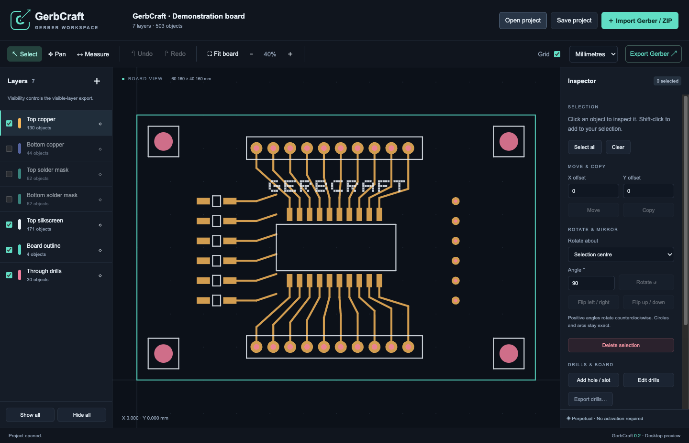
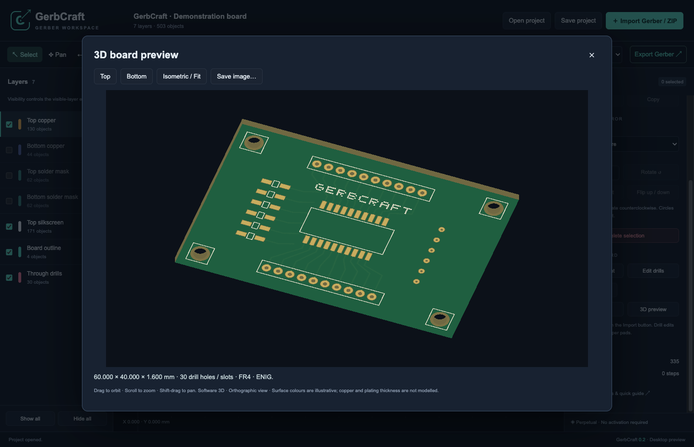
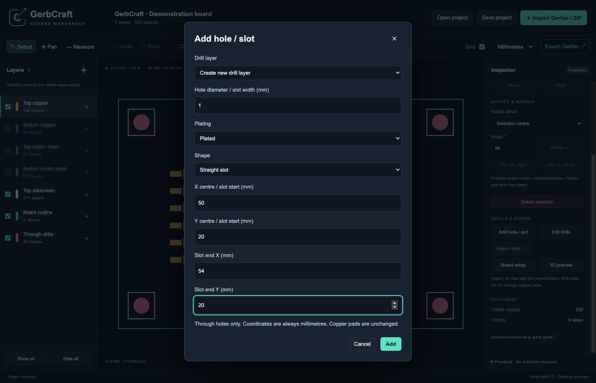

# GerbCraft

**View, edit and explore PCB manufacturing files — even when the original design files are missing.**

Created by [SoloPlax](https://github.com/SoloPlax), GerbCraft is a desktop Gerber editor with layered viewing, direct artwork editing, drill and slot editing, ZIP import, Undo/Redo and a bare-board 3D viewer.

**Current version: 0.2.1 · Windows first · GPLv3 open source · No activation required**

[](https://ko-fi.com/soloplax)



## Why GerbCraft exists

Electronic engineers, hobbyists, makers, students and start-ups often have access to a board's Gerber files but no longer have its original PCB design files. A small change to a pad, track or drill hole can then become difficult, expensive or dependent on specialist software.

SoloPlax created GerbCraft to make those changes more accessible and to build an approachable tool for working directly with manufacturing artwork. The aim goes beyond viewing: bring editing, drill tools, project organisation and 3D inspection together in one desktop application, and keep improving it with the community.

GerbCraft edits manufacturing geometry. It does not reconstruct the original schematic, electrical connectivity or PCB design rules.

## What you can do

- **Open a whole board:** import Gerber and Excellon files individually or directly from a ZIP archive, including its subfolders.
- **Inspect your layers:** change colours, visibility and locks; select objects and measure distances.
- **Edit artwork:** move, copy, delete, rotate and mirror supported geometry, with Undo/Redo.
- **Work with holes and slots:** add, edit, transform and remove through-holes and G85 slots, including diameter and plating.
- **Preview the board in 3D:** inspect copper, solder mask, silkscreen, board cutouts and drills; orbit, pan, zoom and export a PNG.
- **Save and export:** keep editable `.gcraft` projects and export Gerber artwork and separate plated/non-plated drill files.

### Bare-board 3D preview



### Drill and slot editing



These are actual application screenshots captured from a development run using synthetic demonstration artwork. The demonstration board is not a fabrication-ready design and contains no customer artwork.

## Availability

| Platform    | Status                                                                                            |
| ----------- | ------------------------------------------------------------------------------------------------- |
| Windows x64 | Version 0.2.1 installer and portable ZIP built; public release assets have not yet been uploaded. |
| macOS       | A packaged release is next in development.                                                        |
| Linux       | A packaged release is planned alongside macOS.                                                    |

Check [GitHub Releases](https://github.com/SoloPlax/GerbCraft/releases) for published downloads. For now, build from source using the instructions below. Build outputs are kept outside Git: the Windows installer is `dist/editor/GerbCraft-0.2.1-Windows-x64.exe`, with the portable ZIP beside it. Extract the entire portable ZIP before launching.

The Windows acceptance environment is Windows 11 ARM in VMware Fusion using Windows x64 emulation. Native Windows x64 validation remains outstanding. The installers are unsigned, and Windows uses software rendering for VM compatibility.

### Perpetual access and licensing

The current app has **perpetual access by default**, with no activation requirement or expiry. Saving and exporting work without a licence file.

A signed licensing engine and separate **GerbCraft Activation** administrator app have been built, but licence enforcement is disabled in the current public configuration. The administrator app is not needed to use GerbCraft.

GerbCraft is **open-source software under the GNU General Public License, version 3 only** (`GPL-3.0-only`). Copyright (C) 2026 SoloPlax. See [LICENSE](LICENSE) for the full terms.

You may use, study, modify and redistribute GerbCraft, including commercially. When distributing covered versions, you must preserve the required notices, license the covered work under GPLv3, and provide the complete corresponding source as required by that licence. Private modifications do not have to be published. GPLv3 does not add a source-sharing requirement solely because software is used over a network.

GerbCraft is provided without warranty, to the extent permitted by law. Third-party components retain their own licences and notices. The GPL terms apply separately from the disabled activation system; donations are optional and do not affect your rights under the licence.

For binary releases, publish the complete corresponding source and build instructions for that exact version alongside the downloads. The existing local 0.2.1 executables predate this licensing update and must be rebuilt before being offered as GPLv3 release assets.

## Getting started

1. Open GerbCraft and choose **Explore a sample** or **Import Gerber / ZIP**.
2. Select a board ZIP or individual Gerber/drill files. Supporting files in a ZIP are reported and skipped.
3. Inspect layers, make your edits, and use Undo/Redo as needed.
4. Save an editable `.gcraft` project. Export fabrication artwork as `.gbr` and drills separately.

Read the [user guide](docs/USER-GUIDE.md), [licensing architecture guide](docs/ACTIVATION.md), [release checks](docs/RELEASE-CHECKS.md) and [project plan](PLAN.md).

## Supported formats and current limits

- Metric and inch RS-274X, leading/trailing zero omission, absolute/incremental coordinates.
- Circle, rectangle, obround and regular polygon flashes; circular aperture holes.
- Circular-aperture line and arc strokes, single/multi-quadrant arcs and full circles.
- Regions with straight/curved contours, dark/clear polarity and step-and-repeat.
- Aperture macros: circle, outline, polygon, vector line and centre/lower-left rectangles; parameters, variables and arithmetic. Aperture mirror/rotate/scale commands.
- Layer names, colours, visibility and locks; click/Shift-click/box selection.
- 100-step Undo/Redo using structural patches with a 64 MB history budget.
- Excellon absolute holes and G85 slots, including separate PTH/NPTH export.
- Two-copper-layer FR4 board setup and bare-board 3D preview.
- Visible-layer, active-layer or selected-object RS-274X export in millimetres with six decimal places.

Unsupported constructs produce an import error. This version does not support non-circular drawing apertures, aperture blocks, moiré/thermal macro primitives, Excellon routing/repeats/incremental coordinates, blind/buried holes, DXF, ODB++, panelisation or DFM. X2 attributes are read as metadata but omitted from exported artwork with a warning. Password-protected and nested ZIP archives are not supported.

Version 0.2.1 is an early editor release with a defined format scope. Review exported files in an independent CAM tool before fabrication; independent CAM validation remains part of the release checklist.

## Development

Install Node.js and npm, then run:

```sh
npm ci
npm start
```

Validation and Windows packaging:

```sh
npm test
npm run test:ui
npm run build:win
```

Optional licensing administration tools:

```sh
npm run activation
npm run build:activation
```

`npm start` uses the checked-in public licence configuration. Tests use isolated profiles and an unpackaged-only development override; packaged builds ignore that override. Private signing keys are kept outside the repository and never packaged.

The architecture uses pure JavaScript geometry, parser and document modules in `src/core`, a Canvas renderer and desktop UI in `src`, and narrow Electron bridges in `electron`. The renderer has no Node.js access; sandboxing and context isolation are enabled.

Earcut (ISC) and polygon-clipping (MIT), including their dependencies, are locally bundled in `src/vendor`; notices are in `src/vendor/LICENSES.txt`. Rebuild that bundle with `npm run build:geometry` after changing those dependencies. ZIP import uses yauzl and pend (MIT), with their licence notices included.

Regenerate the promotional screenshots with `node scripts/capture-readme.mjs` in a desktop session. The script creates synthetic artwork and uses a temporary application profile.

## Validation so far

Version 0.2.1 passed 43 core tests and 10 desktop tests. Windows VM acceptance covered direct ZIP import, saving and reopening an 11-layer board containing 12,818 objects, including 381 drill holes. ZIP import is atomic and undoable as one operation, with integrity and bounded-size checks.

Private sample boards and acceptance evidence are excluded from this repository. Implementation is independent source code guided by synthetic fixtures and observed workflows. See the [release checklist](docs/RELEASE-CHECKS.md) for completed checks and remaining work.

## Support GerbCraft

You can support development by reporting reproducible bugs, suggesting improvements and sharing the project with other engineers and makers. Please include a small, shareable sample file when reporting a format issue, and remove any confidential board data.

If GerbCraft helps you, you can [support SoloPlax on Ko-fi](https://ko-fi.com/soloplax) to help fund continued development. Contributions are optional; GerbCraft's current perpetual access does not require a donation.
